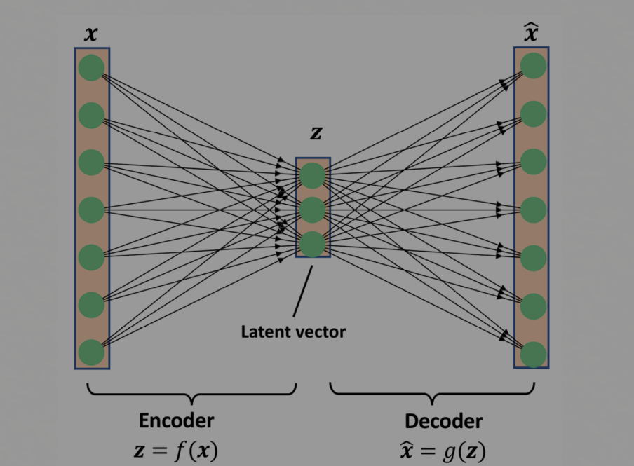
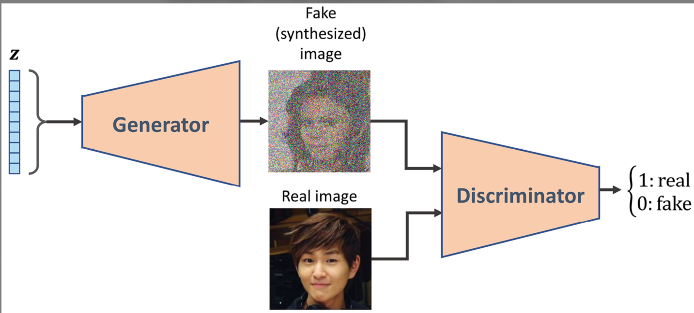
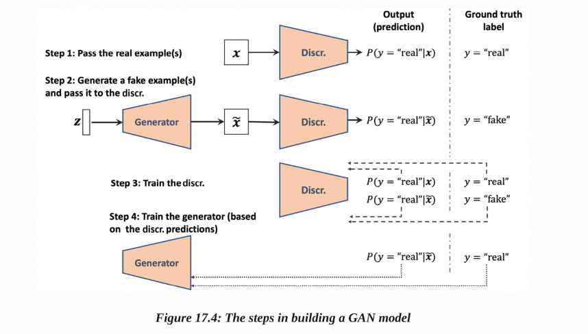

# IMPOTANT: Ignore this repo for now I am working on it; KEEP CHECKING AFTER 2- 3 WEEKS
this repo will cover:
Introducing generative models for synthesizing new data  
Autoencoders, variational autoencoders, and their relationship to GANs     
Understanding the building blocks of GANs
Implementing a simple GAN model to generate handwritten digits
Understanding transposed convolution and batch normalization
Improving GANs: deep convolutional GANs and GANs using the Wasserstein distance
    

 1. Introducing generative models for synthesizing new data    
Generative Adversarial Nets, in Advances in Neural Information Processing Systems by I. Goodfellow, J. Pouget-Abadie, M. Mirza, B. Xu, D. Warde-Farley, S. Ozair, A. Courville, and Y. Bengio, pp. 2672-2680, 2014)

gan image generation: https://www.thispersondoesnotexist.com/

2. Autoencoders, variational autoencoders, and their relationship to GANs 

Learning useful representations in a deep network with a local denoising criterion by Pascal Vincent and colleagues, 2010 (http://www.jmlr.org/papers/v11/vincent10a.html).
https://www.youtube.com/watch?v=sVitINqA0dU
https://ideal.umd.edu/ML4ME_Textbook/part2/gen_models/VAEs.html

# loss functions of the generator and discriminator networks in a GAN model
Generative Adversarial Nets by I. Goodfellow and colleagues (https://papers.nips.cc/paper/5423-generative-adversarial-nets.pdf)

# Implementing a GAN from scratch
for this we will use googl colab jupyter notebook
https://colab.research.google.com
  # Implementing the generator and the discriminator networks
