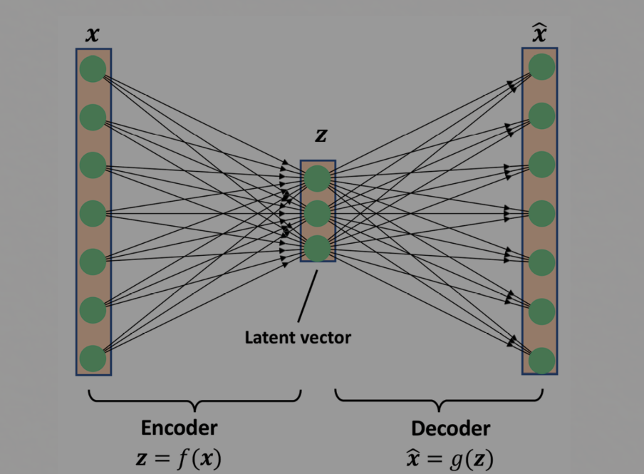
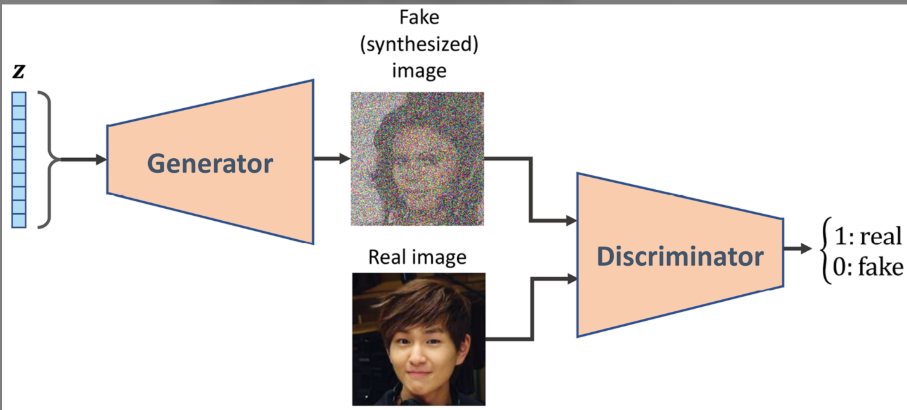
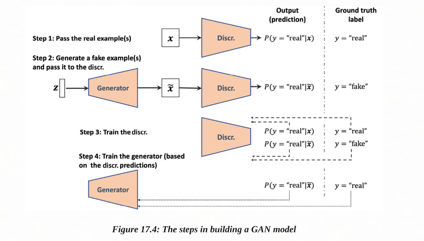
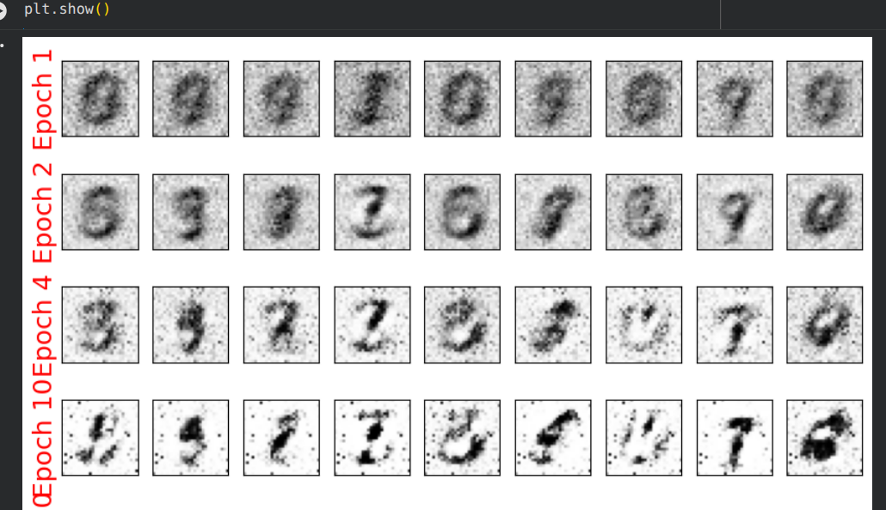
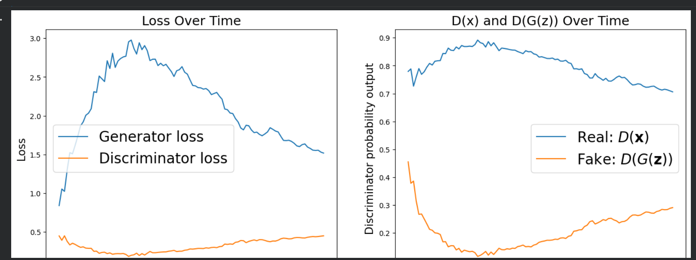
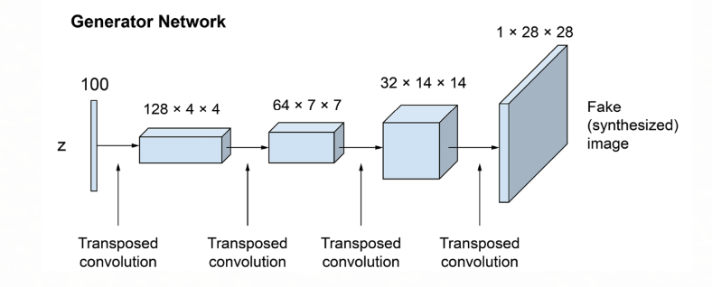
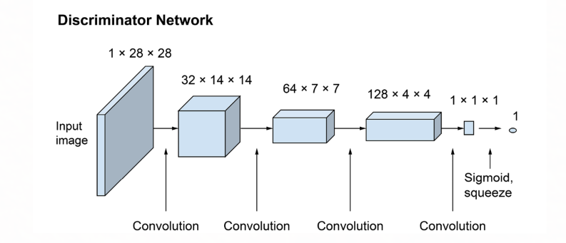
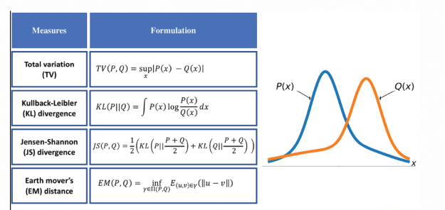
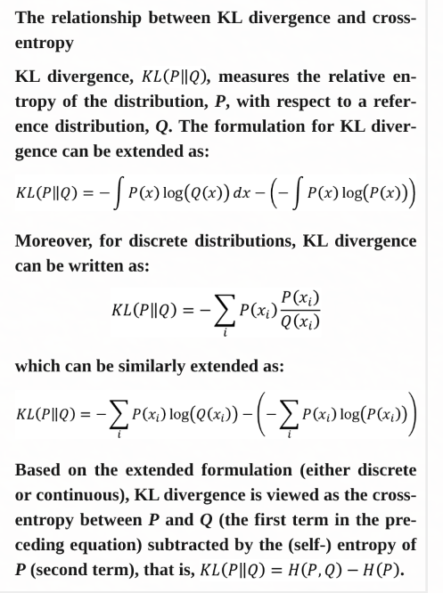

# IMPORTANT: Ignore this repo for now I am working on it; KEEP CHECKING AFTER 2- 3 WEEKS
this repo will cover:
Introducing generative models for synthesizing new data  
Autoencoders, variational autoencoders, and their relationship to GANs     
Understanding the building blocks of GANs
Implementing a simple GAN model to generate handwritten digits
Understanding transposed convolution and batch normalization
Improving GANs: deep convolutional GANs and GANs using the Wasserstein distance
    

 1. Introducing generative models for synthesizing new data    
Generative Adversarial Nets, in Advances in Neural Information Processing Systems by I. Goodfellow, J. Pouget-Abadie, M. Mirza, B. Xu, D. Warde-Farley, S. Ozair, A. Courville, and Y. Bengio, pp. 2672-2680, 2014)

gan image generation: https://www.thispersondoesnotexist.com/

2. Autoencoders, variational autoencoders, and their relationship to GANs 

Learning useful representations in a deep network with a local denoising criterion by Pascal Vincent and colleagues, 2010 (http://www.jmlr.org/papers/v11/vincent10a.html).
https://www.youtube.com/watch?v=sVitINqA0dU
https://ideal.umd.edu/ML4ME_Textbook/part2/gen_models/VAEs.html

# loss functions of the generator and discriminator networks in a GAN model
Generative Adversarial Nets by I. Goodfellow and colleagues (https://papers.nips.cc/paper/5423-generative-adversarial-nets.pdf)

# Implementing a GAN from scratch
for this we will use googl colab jupyter notebook
https://colab.research.google.com

# Implementing the generator and the discriminator networks
# training GAN model and making prediction

# Improving the quality of synthesized images using a convolutional and Wasserstein GAN
Unsupervised representation learning with deep convolutional generative adversarial networks, which is freely available at https://arxiv.org/pdf/1511.06434.pdf. 

# Transposed convolution
A Guide to Convolution Arithmetic for Deep Learning by Vincent Dumoulin and Francesco Visin, 2018 (https://arxiv.org/pdf/1603.07285.pdf.)

https://www.geeksforgeeks.org/machine-learning/what-is-transposed-convolutional-layer/

 # Batch normalization
    

 Batch Normalization: Accelerating Deep Network Training by Reducing Internal Covariate Shift, which you can access via arXiv at https://arxiv.org/pdf/1502.03167.pdf. 

 How Does Batch Normalization Help Optimization?, which is freely available at http://papers.nips.cc/paper/7515-how-does-batch-normalization-help-optimization.pdf.

 # Implementing the generator and discriminator
 

 

 #  Dissimilarity measures between two distributions
 
 https://proceedings.mlr.press/v70/arjovsky17a/arjovsky17a.pdf
 

 # wgan summary based on text above:
 Imagine you are a baker, and you have a perfect cake recipe (the **Real Data**). You want your apprentice (the **Generator**) to learn how to bake the exact same cake.

Here is the deep, logical, and mathematical explanation of how we teach the apprentice, using the concepts from the paper.

### 1. The Problem: How do we know if the cakes are alike?

In machine learning, we need a "ruler" to measure how different the apprentice's cake is from the real one. This ruler is called a **Dissimilarity Measure**.

The paper discusses four famous rulers:

1.  **Total Variation (TV):** Counts the biggest difference in "ingredients" between the two cakes.
2.  **KL Divergence & JS Divergence:** These come from Information Theory. They ask: "If I assume the apprentice's cake is the map, how confused am I when looking at the real cake?"
    *   *The Big Flaw:* If the apprentice bakes a cookie when asked for a cake, these rulers scream "INFINITY" or "ZERO." They don't give a helpful hint on *how* to turn the cookie into a cake. They just say "You are totally wrong."
3.  **Earth Mover (EM) Distance (The Hero):** Imagine your cake and the real cake are two piles of dirt. The **EM Distance** is the **minimum amount of work** (shoveling) required to move the dirt from your pile to match the real pile exactly.
    *   *Why it’s great:* Even if your cake is just a flat pancake and the real one is a tall tower, the EM distance gives you a smooth, logical number: "Move this much dirt from here to there." It never screams "Infinity." It always gives you a gradient (a hint) on how to improve.

### 2. The Logic: Why Traditional GANs Fail

In a traditional GAN, the "Critic" (a judge) tries to distinguish real from fake. The paper proves that traditional GANs essentially minimize the **JS Divergence**.

*   **The Logic Trap:** If the apprentice’s cake is very bad (e.g., a brick), the JS Divergence hits a wall. The gradient becomes **zero**.
*   **The Result:** The apprentice gets no feedback. "Is it closer? Is it worse? I don't know." The apprentice gives up and just bakes random garbage (Mode Collapse).

**WGAN Solution:** We replace the JS ruler with the **EM ruler**. Because the EM distance is smooth and continuous, the apprentice always gets a clear gradient: "Move the dirt from spot A to spot B." This makes training stable.

### 3. The Math: How do we calculate the EM Distance?

Calculating the EM distance directly is incredibly hard because you have to compare every grain of sand in the real cake to every grain in the fake cake.

The paper uses a brilliant mathematical trick called **Kantorovich-Rubinstein Duality**.

Instead of moving dirt, we define a **Judge Function ($f_w$)**.
*   This judge looks at a cake and gives it a score.
*   **The Rule (1-Lipschitz Constraint):** The judge cannot be too dramatic. If you change the cake slightly, the score cannot change by much. Mathematically:
    $$ |f_w(x) - f_w(y)| \leq \|x - y\| $$
    This means the slope of the judge's opinion is limited. The judge is "grounded."

**The WGAN Equation:**
The EM distance is approximately:
$$ \text{EM} \approx E_{x \sim P_{data}}[f_w(x)] - E_{z \sim P_{noise}}[f_w(g_\theta(z))] $$

*   $E[x \sim P_{data}]$: Average score of **Real** cakes.
*   $E[z \sim P_{noise}]$: Average score of **Fake** cakes (generated by the apprentice $g_\theta$).
*   **Goal:** We want the Real cakes to have a high score and Fake cakes to have a low score. The difference between them is our loss!

### 4. The "Little Child" Analogy: The Grumpy Judge

Imagine the **Critic** is a grumpy food critic who tastes cakes.

**Traditional GAN (The Binary Judge):**
*   The judge only says "YUM" (1) or "YUCK" (0).
*   If the apprentice brings a burnt rock, the judge says "YUCK."
*   The apprentice asks, "What should I fix?"
*   The judge says, "It’s completely inedible. I won’t help you." (Vanishing Gradient). The apprentice learns nothing.

**WGAN (The Scored Judge):**
*   The judge gives a score from 0 to 10.
*   **The Constraint (Lipschitz):** The judge is bound by honesty. If you add one sprinkle of sugar, the score can’t jump from 2 to 10. It might go to 2.1. This prevents the judge from being "tricked" by small changes.
*   The apprentice brings a burnt rock. The judge says: "2/10. It tastes like ash."
*   The apprentice brings a slightly better cake. The judge says: "3/10. Still burnt, but moister."
*   The apprentice sees the number go up. They know they are improving! They keep adjusting until the score is high.

### Summary of the WGAN Algorithm (Algorithm 1 in the paper)

1.  **Train the Critic (The Judge):**
    *   Give the critic real cakes and fake cakes.
    *   Teach it to give high scores to real cakes and low scores to fake cakes.
    *   **Crucial Step:** After every update, **clip the weights** of the critic. This ensures the judge stays "1-Lipschitz" (doesn't become too dramatic/overconfident).
2.  **Train the Generator (The Apprentice):**
    *   The apprentice wants to trick the critic.
    *   So, the apprentice generates a fake cake.
    *   The critic scores it.
    *   The apprentice updates its recipe to **maximize** that score (make the judge think it's real).

### Why this is better

*   **Meaningful Loss:** The loss value (the score difference) actually tells you how good your model is. If the loss goes down, your samples are getting better. In traditional GANs, the loss curve is useless noise.
*   **No Mode Collapse:** Because the gradient is always available (thanks to the smooth EM distance), the apprentice learns to make *all* types of cakes in the training set, not just one type.
*   **Stability:** You don't need to balance the critic and generator perfectly. You can train the critic more, and it only helps the generator by providing better gradients.

**In short:** WGAN replaces a broken, binary "Yes/No" judge with a smooth, constrained "Score 0-10" judge, allowing the generator to learn from small, continuous improvements.

## GRADIENT PENALTY ON WGAN
https://arxiv.org/pdf/1704.00028
